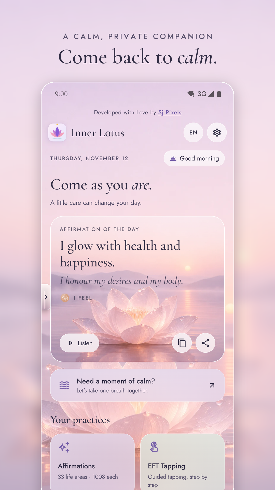
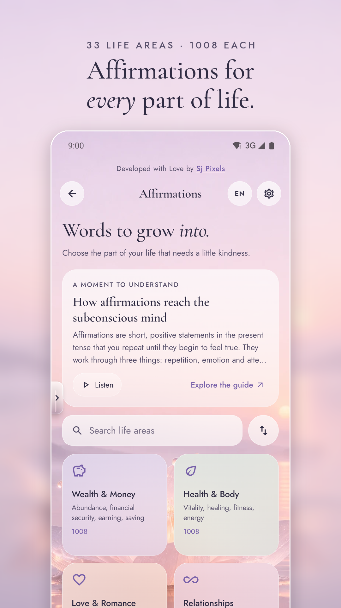
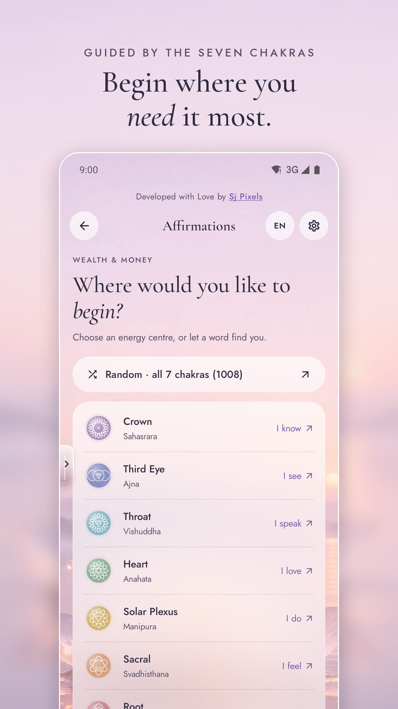
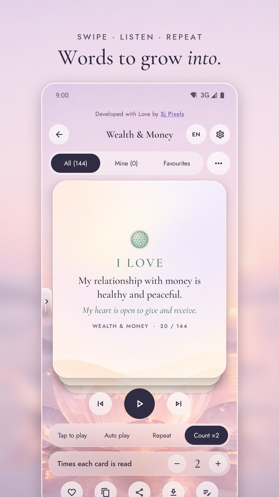
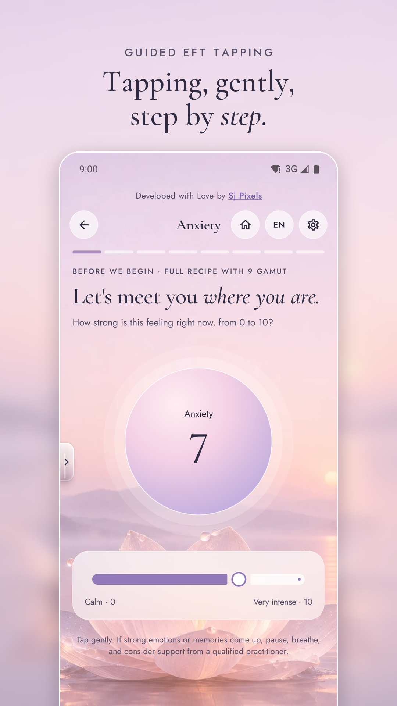
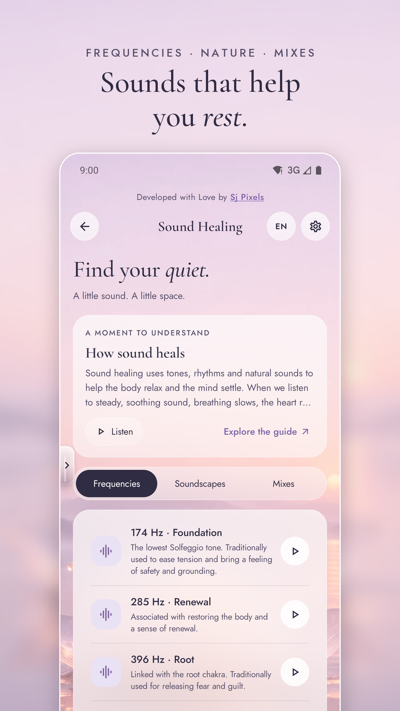
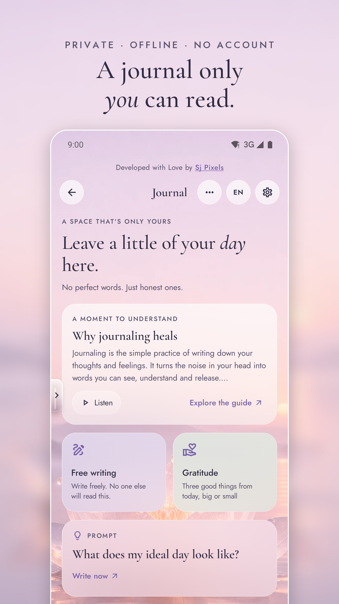
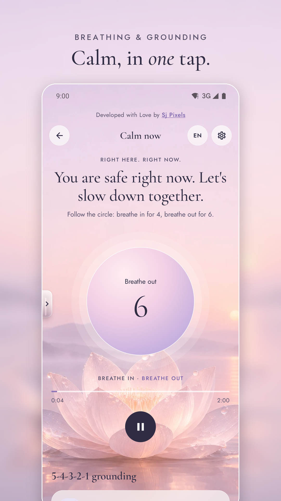

<div align="center">


# Inner Lotus

***Come as you are.***

A calm, private self-care companion for Android

Affirmations · EFT tapping · Sound · Ho'oponopono · Journal · Habits · Breathwork · Chakras, in 9 languages

<a href="https://play.google.com/store/apps/details?id=com.sjpixels.innerlotus"></a>

[](https://sjpixels.com/)
[](https://sjpix7.github.io/InnerLotus/privacy-policy.html)
[](https://play.google.com/store/apps/details?id=com.sjpixels.mantramala)


-3DDC84?logo=android&logoColor=white)


[](LICENSE)


</div>

---

<a id="about"></a>
##  About

Inner Lotus is an offline self-care app for Android by [Sj Pixels](https://sjpixels.com/). It brings affirmations, EFT tapping, sound, Ho'oponopono, journaling, a habit tracker, breathwork and a chakra guide together in one quiet app, in 9 languages. There's no account, no ads and no tracking, and nothing leaves the phone.

| | |
|---|---|
|  **Package** | `com.sjpixels.innerlotus` |
|  **Status** | v1.0.0 submitted to Google Play (November 2026) |
|  **Stack** | Kotlin 2.2 · Jetpack Compose (BOM 2025.12) · Material 3 · AGP 8.13 · Gradle 8.14 |
|  **SDK** | compileSdk / targetSdk 36 · minSdk 26 (Android 8.0+) |
|  **Privacy** | No internet permission, servers, accounts, ads or analytics. Everything stays on the device. |

<a id="contents"></a>
##  Contents

- [Screenshots](#screenshots)
- [Features](#features)
- [Design](#design)
- [Languages](#languages)
- [Open, build and run](#build)
- [Project structure](#structure)
- [Editing content and translations](#editing)
- [Tests](#tests)
- [Permissions (and why)](#permissions)
- [Publishing](#publishing)
- [Credits and licences](#credits)

---

<a id="screenshots"></a>
##  Screenshots

<div align="center">








</div>

---

<a id="features"></a>
##  Features

| | Section | What it does |
|:-:|---|---|
|  | **Affirmations** | 33 life areas × 1008 unique affirmations each (33,264 per language). Swipe through a stack of cards, start from one chakra (Root → Crown, "I AM … I KNOW") or let all 7 guide you. Favourites, copy, share as an image, save to Pictures/InnerLotus. Read aloud with the phone's own voice in 4 modes: tap, auto-play with auto-swipe, repeat, or ×N count. Bulk-edit your own lines per area. Import/export as JSON, CSV or TXT, for the whole library or one section. |
|  | **Learn** | Short, research-informed guides to affirmations, EFT, Ho'oponopono, journaling, sound, breath and chakras, each with a Listen button. |
|  | **EFT Tapping** | 12 guided topics × 4 techniques (Basic, Full with 9 Gamut, Gentle touch & breathe, Positive round). Includes a 0–10 rating before and after, a drawn tapping-point figure and optional voice guidance. |
|  | **Sound** | 17 frequencies (Solfeggio, 432 Hz, OM 136.1 Hz, Schumann and binaural delta to gamma) plus 22 nature sounds, instruments and noise textures, all synthesised live with no audio files. Mix any number of layers at their own volumes, save mixes, use 8 presets, play an endless "journey", set a sleep timer and keep playing in the background. A floating mini player follows you around the app. |
|  | **Ho'oponopono** | 15 topics, one of them a person you name. The prayer is editable and can be read once, looped, or repeated a set number of times. |
|  | **Journal** | Free, Gratitude and Prompt modes (30 prompts), moods shown as gentle weather (sun, lotus, cloud, umbrella, waves, storm), grouping by day, week or month, search, a 30-day mood summary, JSON/TXT export and import, delete by entry, group or all, and an optional PIN lock (salted SHA-256). |
|  | **Habit Tracker** | Simple daily habits with 24 line icons, colours, times per day and weekdays. Streaks, a 12-week heatmap, a weekday rhythm and per-habit stats. **App usage** shows screen time for today, 7 days and 30 days from Android's UsageStatsManager, after the user grants Usage access. |
|  | **Breathwork** | Box, 4-7-8, Coherent, Cyclic sighing, Nadi Shodhana, Bhramari and Calming breath, guided by a glowing breathing orb with optional spoken cues. |
|  | **Chakra Guide** | Each chakra's location, element, bija mantra, themes, balanced and imbalanced signs and practices, with its tone. |
|  | **Calm now** | A one-tap calm space: breathing circle, 5-4-3-2-1 grounding, tapping for anxiety, a calm-rain mix and crisis helplines (Tele-MANAS 14416, findahelpline.com). |
|  | **Mantra chanting** | Links to the companion [Mantra Mala](https://play.google.com/store/apps/details?id=com.sjpixels.mantramala) app. This app intentionally has no mantra counter. |
|  | **Everywhere** | A glass sidebar on the left edge jumps to any section (with tooltips). Language chip ("EN") and settings in the top bar. "Developed with Love by Sj Pixels" credit at the top of every page. Background is the glass lotus at dawn by default, or rotates every N seconds through 19 images. Daily reminders. Masculine/feminine form of address for gendered languages. |

---

<a id="design"></a>
##  Design

The UI follows a **"glass lotus at dawn"** design system: subtle, calm and self-explanatory.

- **Real frosted glass.** Every card, button, bar and sheet draws a blurred slice of the background behind it, a soft tint and a hairline light edge (`ui/glass/Glass.kt`).
- **Typography.** Cormorant Garamond for headings, quotes and numbers (with one *italic* word per header and lining numerals) and Jost for UI text. Hindi, Chinese, Japanese and Korean use the system font.
- **Line icons only.** Thin Material *Outlined* icons, never emoji (`ui/icons/LotusIcons.kt`). Language flags in the language list are the one exception.
- **Soft colour.** Ink `#302C43` for text and the one primary pill per screen, lavender-violet accents (`#7760A9`), and muted chakra tones in rainbow order.
- **One voice per screen.** A small letter-spaced kicker, a serif headline, and a muted subtitle.

The full guide, with tokens, type roles and components, is in **[docs/design/DESIGN_SYSTEM.md](docs/design/DESIGN_SYSTEM.md)**. The HTML reference prototype is in `docs/design/prototype/` (open `index.html`).

---

<a id="languages"></a>
##  Languages

| 🇬🇧 **English** | 🇮🇳 **हिन्दी** (Hindi) | 🇷🇺 **Русский** (Russian) |
|---|---|---|
| 🇰🇷 **한국어** (Korean) | 🇨🇳 **简体中文** (Chinese, Simplified) | 🇪🇸 **Español** (Spanish) |
| 🇫🇷 **Français** (French) | 🇮🇹 **Italiano** (Italian) | 🇯🇵 **日本語** (Japanese) |

---

<a id="build"></a>
##  Open, build and run

1. Install a current **Android Studio** (Narwhal 2025.1.3 or newer). It bundles a JDK 17+ and the Android SDK.
2. **File → Open…** and choose this folder. Let Gradle sync; it downloads Gradle 8.14.3 and all dependencies.
3. Pick a device or emulator (Android 8.0+) and press **Run**. The debug build installs as `com.sjpixels.innerlotus.debug`, next to any release build.

From a terminal (JDK 17):

```bash
./gradlew assembleDebug          # app/build/outputs/apk/debug/
./gradlew installDebug           # build + install on a connected device/emulator
./gradlew lintDebug              # Android lint
./gradlew bundleRelease          # app/build/outputs/bundle/release/app-release.aab (for Play)
```

<a id="signing"></a>
###  Release signing

Release builds are signed with the upload key named in `keystore.properties` in the project root. That file is **git-ignored and must never be committed or shared**.

```properties
storeFile=/absolute/path/to/innerlotus-upload.jks
storePassword=••••••
keyAlias=upload
keyPassword=••••••
```

To create a new upload key, use **Build → Generate Signed App Bundle** in Android Studio, or run (on macOS with Homebrew's JDK, use the full path `/opt/homebrew/opt/openjdk@17/bin/keytool`):

```bash
keytool -genkey -v -keystore ~/innerlotus-upload.jks -keyalg RSA -keysize 2048 -validity 10000 -alias upload
```

The app uses **Play App Signing**: Google holds the app signing key, and your keystore is only the *upload* key. Back it up with its password somewhere safe. Check a signed bundle with `jarsigner -verify app/build/outputs/bundle/release/app-release.aab`.

For every update, bump `versionCode` (2, 3, …) and `versionName` in `app/build.gradle.kts`.

---

<a id="structure"></a>
##  Project structure

```
app/src/main/
  AndroidManifest.xml
  assets/i18n/<lang>.json          ← generated by tools/build_content.py (don't edit by hand)
  res/drawable-nodpi/bg_*.webp     ← 19 backgrounds; bg_dawn.webp is the signature glass lotus
  res/font/                        ← Cormorant Garamond (+ italic) and Jost, variable fonts (OFL)
  java/com/sjpixels/innerlotus/
    App.kt                         ← Application, Screen routes, Navigator, singletons
    MainActivity.kt                ← root composable, onboarding, back handling
    core/      Lang, I18n, StringTable (gender markup), Catalog (ids, colours), AppSettings
    content/   Composer (1008-card maths), Affirm (cards), Practices (breath patterns, prayer)
    data/      JSON stores: affirmations, journal, habits, mixes; analytics; CSV; backup
    audio/dsp/ real-time synthesis: filters, noise, modal bells/bowls, Karplus-Strong, reverb, mixer
    audio/     SoundEngine (AudioTrack thread), SoundService (foreground, mediaPlayback)
    tts/       Speaker (Android TextToSpeech wrapper, chunking, language switching)
    usage/     UsageRepo (UsageStatsManager)
    share/     card image rendering, share, save to gallery, clipboard, SAF files
    reminders/ daily notifications (AlarmManager inexact), boot receiver
    ui/glass/      frosted-glass engine (pre-blurred backdrop slices, Modifier.glass)
    ui/icons/      LotusIcons: every pictogram as a Material Outlined icon
    ui/theme/      Lotus colour tokens, type roles (LotusType), canvas fonts for share cards
    ui/components/ Design.kt (glass surfaces, buttons, fields, tiles, orb), scaffold, sidebar, charts
    ui/screens/    one file per section
content/src/<lang>/*.txt           ← all translatable text (source of truth)
tools/build_content.py             ← validates + builds the JSON
tools/expand_gender.py             ← expands Hindi shorthand करता{|ी} → {करता|करती}
tools/jvmtest/                     ← JVM tests for the Android-free code
tools/store/                       ← store art: compose_store_art.py (screenshots + feature graphic),
                                     render_store_assets.js (512px icon)
docs/                              ← Play Console guide, privacy policy, design system, store art, licences
docs/readme/icons/                 ← the Material Outlined icons used in this README
```

---

<a id="editing"></a>
##  Editing content and translations

All text lives in `content/src/<lang>/` as plain text files: `areas.txt`, `chakras.txt`, `learn.txt`, `eft.txt`, `practices.txt`, `ui.txt`.

```text
key = single line value
key:
- list item
- list item
key <<
multi-line block
>>
# comment
```

After editing, run:

```bash
python3 tools/build_content.py           # validate + write app/src/main/assets/i18n/*.json
python3 tools/build_content.py --check   # validate only
```

The validator checks every language against English: same keys, same list lengths, same `{placeholders}`, and well-formed gender markup.

- **Italic accents.** Screen titles may wrap one word in `*asterisks*` (e.g. `ui.hero.sound.title = Find your *quiet*.`). It renders in Cormorant italic.
- **Singular forms.** A string with a `{n}` count can have an optional `<key>__one` variant (e.g. `ui.journal.entries_n__one = {n} entry`), used when `n` is 1. Add it only in languages that inflect (en, es, fr, it, hi). It is never borrowed from English, so languages without one always use the main key.
- **Affirmations** are composed as 24 area lines × 6 chakra seed lines × 7 chakras = 1008 per area. Keep each area's 24 lines unique, and keep them unique across areas too; the tests check this.
- **Gender:** in Hindi, Russian, Spanish, French and Italian, write `{masculine|feminine}` with whole words, e.g. `{grato|grata}` or `{करता|करती}`. The app resolves it from **Settings → Speak to me as** (feminine by default; also asked during onboarding).
- **Adding a language:** add an entry to `core/Lang.kt` (code, flag, native name, BCP-47 tag, gendered?, Latin script?), add the code to `LANGS` in `tools/build_content.py`, create `content/src/<code>/` by copying `en/`, translate it, and build.
- **Adding an area:** add the id and background to `Catalog.areas`, an icon in `LotusIcons.area()`, then `area.<id>.name/.desc/.lines` (24 lines) in every language.

---

<a id="tests"></a>
##  Tests

```bash
tools/jvmtest/run.sh            # needs a Kotlin compiler + kotlinx-serialization/coroutines jars (see script header)
```

These cover:

- Deck maths: 144 unique cards per chakra and 1008 per area.
- Real content in all 9 languages and both address forms: 33 × 1008 unique cards with no stray markup.
- Gender and placeholder resolution, the prayer builder, all data stores (round-trip, import, merge, delete), streaks and analytics, and CSV.
- All 39 sounds, rendered with checks for level, NaN and real-time speed.

In Android Studio you can also move `PureTests.kt` into `app/src/test/` as a normal unit test.

---

<a id="permissions"></a>
##  Permissions (and why)

| Permission | Why |
|---|---|
| `PACKAGE_USAGE_STATS` | Optional App-usage screen. The user turns it on in system settings after an in-app explanation. Data is read on the device only. |
| `POST_NOTIFICATIONS` | Daily affirmation and journaling reminders (asked only when the user enables one). |
| `RECEIVE_BOOT_COMPLETED` | Re-schedules reminders after a reboot. |
| `FOREGROUND_SERVICE`, `FOREGROUND_SERVICE_MEDIA_PLAYBACK`, `WAKE_LOCK` | Keeps user-started sounds playing with the screen off, with a Stop button in the notification. |
| `WRITE_EXTERNAL_STORAGE` (max SDK 28) | Saves card images on Android 8–9 only. |

There is **no** `INTERNET` permission and no advertising ID. Backups are disabled (`allowBackup=false`, with data-extraction rules excluding everything), so journal data never leaves the phone unless the user exports it.

---

<a id="publishing"></a>
##  Publishing

- **Play Console guide:** [docs/PLAY_STORE.md](docs/PLAY_STORE.md) has the store listing (with titles and short descriptions in 9 languages), Data safety answers, the Health apps declaration, content rating and the release checklist.
- **Privacy policy:** hosted with GitHub Pages from `docs/` at **https://sjpix7.github.io/InnerLotus/privacy-policy.html** (source: `docs/privacy-policy.html`, plus [PRIVACY_POLICY.md](PRIVACY_POLICY.md)).
- **Store art:** `docs/store/`: the 512px icon, the 1024×500 feature graphic and 8 framed 1080×1920 screenshots. Regenerate them after UI changes with `python3 tools/store/compose_store_art.py <raw_screens_dir>`.
- **Releasing an update:** bump `versionCode`/`versionName`, run `./gradlew bundleRelease`, verify the signature, then upload the `.aab` in Play Console → Production → Create new release.

---

<a id="credits"></a>
##  Credits and licences

- Code, content, chakra artwork and synthesised sounds: © 2026 Sj Pixels, licensed under the **[GNU General Public License v3.0](LICENSE)**. You may use, study, share and modify this project, but any distributed version, modified or not, must also be released under GPLv3 together with its source code.
- Fonts: Cormorant Garamond and Jost under the SIL Open Font License 1.1 (`docs/licenses/`).
- Icons: [Material Icons](https://fonts.google.com/icons) (Outlined) by Google, Apache License 2.0.
- Background images: the glass-lotus image and the photos from the supplied `theme-bg.zip`. Make sure you hold the rights to publish them.
- The wellness content is educational and is not medical advice; see the in-app disclaimer.

---

<div align="center">


Developed with Love by **[Sj Pixels](https://sjpixels.com/)**

</div>
